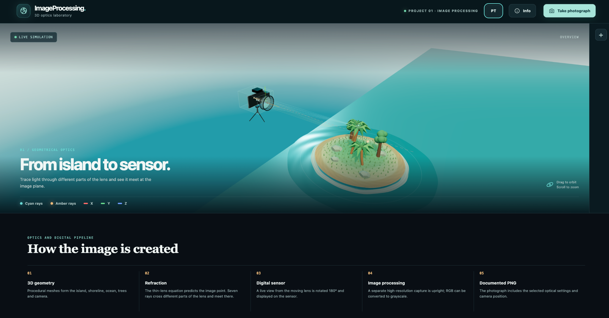

# ImageProcessing — 3D Optics Lab

An interactive image processing and geometrical optics project. Explore how light from a 3D island passes through a converging lens and forms an image on a digital sensor inside a transparent, movable camera.



## Features

- **Interactive 3D scene:** an island, ocean, transparent camera body, lens, sensor, optical axis and color-coded coordinate axes.
- **Geometrical optics:** rays from each selected object point pass through different parts of the lens and converge at the same image point on the sensor plane.
- **Movable camera:** move the physical camera up, down, left, right, forward or backward. The island stays in place; the rays and sensor image respond to the new camera position.
- **Live sensor and photograph:** the sensor displays the inverted image formed by the lens; a separate, higher-resolution photograph is saved upright.
- **Image processing:** inspect capture information and download the photograph as an RGB or grayscale PNG with technical details drawn on the image.
- **Accessible controls:** responsive layout for desktop and mobile, collapsible camera controls, English by default, Portuguese toggle and an Info panel.

## Run locally

From this directory, start a local HTTP server:

```bash
python3 -m http.server 8000
```

Then open `http://localhost:8000/` in a WebGL-capable browser. The Three.js modules are included in `vendor/`, so no package installation or internet connection is needed to run the site. Opening `index.html` through `file://` may block JavaScript modules.

## Controls

| Action | Control |
| --- | --- |
| Move the physical camera | On-screen direction buttons, or **W/S** (up/down), **A/D** (left/right) and **Q/E** (forward/backward) |
| Return the physical camera to its initial position | **Centre** |
| Change the *view of the simulation* | Drag to orbit; scroll or pinch to zoom; or select **Overview**, **Rays** or **Sensor** |
| Adjust the lens and scene | Focal length, exposure, light intensity and visibility toggles |
| Make more room for the scene | **−** minimizes the camera controls; **+** expands them |
| Capture and export | **Take photograph**, select **RGB** or **Grayscale**, then **Download image with information** |

The photo is rendered separately from the small live sensor preview. Depending on the device, capture resolution can be 3840 × 2160, 2560 × 1440 or 1920 × 1080 pixels. The downloaded PNG includes visible technical information; it does not contain EXIF metadata. Grayscale conversion uses luminance weights `0.2126 R + 0.7152 G + 0.0722 B`.

## Optical model

The simulation uses the ideal thin-lens equation and signed magnification:

```text
1/f = 1/u + 1/v       v = (f × u) / (u − f)       m = −v/u
```

Here `f` is focal length, `u` is object distance and `v` is the distance from the lens to the image plane. Several rays from each sampled object point cross the lens aperture at different locations and converge at its calculated image point. Camera movement updates the lens position, ray paths and sensor view. The model uses a scale of **45 mm per 3D scene unit** and illustrates ideal geometrical optics; it does not simulate lens aberrations, diffraction or physical depth of field.

## Technology and project files

- `index.html`, `style.css` — page structure and responsive design.
- `app.js` — Three.js scene, camera interaction, live sensor and photo capture.
- `optics.js`, `image-processing.js` — lens geometry and pixel conversion.
- `translations.js` — English and Portuguese interface text.
- `vendor/` — local Three.js and OrbitControls modules, with their license.
- `assets/site-preview.png` — screenshot displayed in this README.
- `tests/`, `package.json` — optional for running the website, useful for verifying the optical and image processing behavior.

Run the automated checks with Node.js:

```bash
npm test
```

Created by Computer Engineering student Alberto Junior, with the help of AI.
